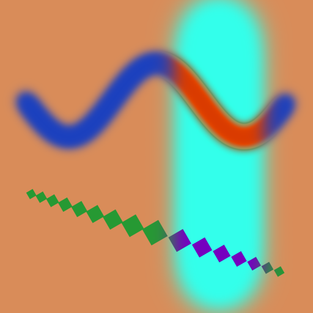

# PhotoCraft as Overcast's layer / mask / brush engine: evaluation and spike

Date: 2026-10-18 · Branch: `overcast-spike` (fork `plymoon/photocraft`, base `main` @ `8d2e615`) ·
Prototype: [`overcast-engine/`](overcast-engine/)

## Кратко (для владельца)

- **Вердикт: частичное заимствование (partial adopt).** Берём как библиотеку пять «пиксельных»
  крейтов PhotoCraft: `geom`, `color`, `raster` (разреженные COW-тайлы 256²), `paint` (кисть) и
  `compose` (эталонный CPU-композитор, 30+ режимов наложения, 16 типов коррекций, маски).
  `gpu` (wgpu 30) — опционально, для предпросмотра. Командный реестр, MCP, `io`, UI — **не берём**:
  они тянут за собой весь редактор (engine ≈ 117 тыс. строк, зависит от io/text/plugins/codecs…).
- **Модель стека — своя** (Overcast: каналы PBR, UDIM, стек операций маски, ссылки на библиотечные
  маски). PhotoCraft используется как «ядро пикселей»: на каждый PBR-канал и каждый UDIM-тайл
  собирается `photocraft_doc::Document`, который композитится той же функцией, что и в редакторе.
- **Прототип работает**: стек 2048² (заливка; слой краски с мягким круглым и повёрнутым квадратным
  мазком; Hue/Saturation по маске) — CPU-композит → PNG 8/16 бит; Python через PyO3/maturin
  (`composite()`, `stroke()`, класс `Stack`); `cargo check --target wasm32-unknown-unknown` проходит;
  13 тестов зелёные. GPU: в контейнере нет адаптера wgpu — код собран, запуск пропущен (см. §6).
- **Главные пробелы**: нет многоканальных (PBR) стеков и UDIM; маска — один растр, а не стек операций;
  нет ссылочных масок, 3D-шума по position map, мазков в screen-space; композит идёт в display RGB
  (как Photoshop), а не в линейном свете, и нет нормализации для normal map.
- **Лицензия**: MIT OR Apache-2.0 — совместима с GPL-3.0-or-later Overcast. Нужно сохранять
  копирайт/NOTICE. Имя и логотипы ArtCraft — товарные знаки, их использовать нельзя.
- **Оценка**: адаптер Overcast поверх PhotoCraft до уровня MVP ≈ 6–9 человеко-недель (детали в §7).

---

## 1. Crate map

The task brief said 24 crates; `main` at `8d2e615` has **26** under `crates/` plus 4 apps and
`xtask`. Layers are enforced by `cargo xtask layers` (`xtask/src/layers.rs`): a crate may depend
only on lower layers, and nothing below L6 may use egui/eframe/winit/rfd.

| Layer | Crate | ~LOC | What it is | Usable headless as a library? |
|---|---|---:|---|---|
| L0 | `geom` | 1.7k | `Rect`, `Size`, `Point`, `Affine`, `TileCoord`, `TILE_SIZE = 256` | **Yes** (serde only) |
| L0 | `cms` | 4.6k | ICC colour management (`Transform`, cached transforms) | Yes (no deps) |
| L0 | `color` | 1.4k | `PixelFormat` (mode × U8/U16/F32 × alpha), `BlendMode`, blend math, `Color` | **Yes** |
| L0 | `raster` | 1.8k | `Surface`: sparse COW 256² tiled plane in any `PixelFormat` | **Yes** |
| L0 standalone | `psd`, `codecs`, `heif`, `raw`, `affinity`, `ipp`, `tablet` | 3–14k each | File formats, pen-tablet input (the only `unsafe`, macOS) | Yes, but not needed by Overcast (except maybe `codecs` for EXR/TIFF) |
| L1 | `doc` | 5.1k | Document model: `Document`, `Layer`, `LayerContent`, `LayerMask`, `Adjustment`, `Fill`, effects | **Yes** (pure data) |
| L2 | `ops` | 1.0k | Undo history (whole-document COW snapshots) | Yes |
| L2 | `paint` | 8.1k | Brush engine: tips, dynamics, dabs, stroke renderer, presets, mixer, retouch | **Yes** |
| L2 | `algo` | 55k | Imaging algorithms (blur, selection expand/contract/feather, noise, content-aware…) | Yes (large; take selectively) |
| L2 | `text`, `vector` | 11k, 4k | Type engine (parley/skrifa), paths and shapes | Yes (`vector` is pulled in by `compose`) |
| L3 | `compose` | 15k | **CPU reference compositor** (the oracle the GPU must match) | **Yes** |
| L3 | `gpu` | 6.2k + WGSL | **wgpu compositor** (wgpu **30**), paged residency, planner | Yes (needs a wgpu device) |
| L3 | `format` | 4.5k | `.pcraft` native file format | Yes |
| L4 | `io`, `plugins` | 22k, 1k | Document ⇄ PSD / flat formats; sandboxed WASM plug-ins (wasmi) | Yes, but heavy |
| L5 | `engine` | 117k | `Session` + command registry (~700 command ids), jobs, history glue | Technically yes (no egui), but it pulls in nearly every crate (io, text, plugins, codecs, raw, affinity, format…) |
| L6 | `ui-egui` | 193k | The egui shell | **No** (UI) |
| L6 | `automation` | 4.9k | MCP server (rmcp 3.5 + tokio) over the engine | Only together with `engine` |
| — | `testkit` | 0.3k | Test helpers | dev only |

Apps: `photocraft` (desktop, eframe/wgpu, TCP control server), `photocraft-cli` (headless
convert/info/run/batch/mcp), `photocraft-web` + `photocraft-web-boot` (same app on wasm).

**Library-usable without egui:** everything at L0–L5. The *useful* minimal closure for Overcast is
`geom + color + raster + doc + paint + compose` (+ `vector`, which `compose` needs, and optionally
`gpu`, `algo`). That closure has only `serde`, `serde_json` and `rayon` (native only) as external
dependencies, plus `rustfft` for `algo` and `wgpu` for `gpu`.

## 2. Subsystems

### 2.1 Sparse tile store — `photocraft-raster`

- **Key types:** `Surface` (an infinite plane of `Arc<Tile>` in a `BTreeMap<TileCoord, _>`, a
  per-surface default pixel for missing tiles), `Tile` (256² interleaved bytes), `AllocationError`,
  `Interrupt`/`Cancelled` (cooperative cancellation).
- **API:** `Surface::new(fmt)`, `with_default(fmt, &[f32])` (e.g. a mask that reads 0 or 1 where
  untouched), `tile(c)`, `tile_mut(c)` / `try_tile_mut(c)` (COW: copies only that tile), `tiles()`,
  `tile_count()`, `read_region/write_region` (f32), `read_rgba_into`, `fill_rect`, `prune()`
  (drops tiles equal to the default), `take_tiles/put_tiles`, `convert(fmt)`, `map_color`, fallible
  `try_*` variants for every allocation.
- **Depth:** any `PixelFormat` = `ColorMode` (Gray, RGB, CMYK, Lab, Multichannel, …) ×
  `SampleType::{U8, U16, F32}` × alpha. All public read/write paths speak f32.
- **Coupling:** depends on `geom` + `color` only. Cloning a surface is O(tiles) pointer copies —
  exactly the snapshot/undo/background-bake model Overcast wants.
- **Fit for Overcast:** excellent. Storage is already "only touched 256² blocks". Missing: a
  serialisation of tiles on its own (the `.pcraft` format does it at document level), channel
  counts beyond the colour model (a 1-channel `Grayscale` surface works for roughness/metallic/
  height/AO; a 3-channel RGB for albedo/normal).

### 2.2 Compositors — `photocraft-compose` (CPU) and `photocraft-gpu` (wgpu 30)

- **CPU:** `render(&Document, Rect) -> Buffer` (straight-alpha `[f32; 4]` rows), `render_tiled`,
  `render_bands` (streaming), `composite_to_surface(doc, rect, fmt, bg)`, `flatten`,
  `render_layer`, `thumbnail`. Parallel with rayon on native, single-threaded on wasm. Encodes
  Photoshop semantics: blend modes, opacity × fill, masks with density, clipping groups,
  pass-through vs isolated groups, adjustments applied to the composite below, fill layers, layer
  effects, blend-if, knockout. It is the **oracle**: the GPU path is tested against it within
  1/255 (`crates/gpu/tests/parity.rs`).
- **GPU:** `Compositor::try_new_with_format(&device, Compositor::preferred_acc_format(&adapter))`,
  `supports(&doc)`, `render(device, queue, doc, rect, sink)` (chunks handed to a sink, no readback),
  `render_to_vec(...)` (readback, native only), memory budgets, device-loss handling
  (`DeviceHealth`, `Fault`). Accumulates in `Rgba32Float` (or `Rgba16Float` fallback). Pages up to
  the device texture limit; only changed `Arc` tiles re-upload. **wgpu = 30** (`default-features =
  false, features = ["std", "wgsl"]`; the app enables WebGPU + WebGL2 on the web through eframe).
  Unsupported cases return `Unsupported(String)` and the caller falls back to the CPU.
- **Colour:** compositing happens in **display (gamma-encoded) RGB**, like Photoshop's default — not
  linear light. Values are not colour-managed unless the document has a profile, so data channels
  (roughness, height…) pass through numerically; but "Normal" blending of a normal map is a plain
  lerp (no renormalisation).
- **Coupling:** `compose` needs `doc` + `vector` (for shape/vector masks). `gpu` needs `compose`
  (shared planning helpers) and wgpu.

### 2.3 Blend modes — `photocraft-color::blend` + `compose::psblend`

`BlendMode` has 34 variants: PassThrough, Normal, Dissolve, Darken, Multiply, ColorBurn,
LinearBurn, DarkerColor, Lighten, Screen, ColorDodge, LinearDodge, LighterColor, Overlay,
SoftLight, HardLight, VividLight, LinearLight, PinLight, HardMix, Difference, Exclusion, Subtract,
Divide, Hue, Saturation, Color, Luminosity, plus six Paint.NET modes. Serde-serialisable by name
(the spike's JSON uses `"blend": "Multiply"`). Matched against Photoshop-authored corpus files, at
8/16/32-bit (32-bit modes don't clip). Per-channel exclusion exists (`Layer::excluded_channels`,
Photoshop's Advanced Blending › Channels) — a building block for per-PBR-channel enable.

### 2.4 Adjustment layers — `photocraft-doc::Adjustment` + `compose::adjust`

16 kinds: Brightness/Contrast, Levels, Curves, Exposure, Vibrance, **Hue/Saturation** (master +
six hue ranges, colorize), **Color Balance**, Black & White, Photo Filter, Channel Mixer, Color
Lookup, Invert, Posterize, Threshold, Gradient Map, Selective Color (+ `Unsupported` raw keeper).
Units are Photoshop's (hue in degrees, saturation/lightness in percent; Levels in 0..1 with gamma).
Depth-aware (`adjustment_quantum(depth)`; 32-bit paths don't clamp). All three adjustments the brief
names (levels / HSL / color balance) exist. Apply to "the composite below", masked by the layer's
mask, exactly the Substance/Photoshop semantics Overcast wants.

### 2.5 Pixel masks — `photocraft-doc::LayerMask`

`LayerMask { surface: Surface, enabled, linked, density, feather }` — one grayscale sparse surface
per layer (default pixel = reveal-all or hide-all), plus `Layer::vector_mask`, clipping (`clipped`)
and document `channels` (saved alpha channels). Mask depth follows the surface format (the spike
uses U16 / F32 masks; the compositor reads f32). Dense helpers for mask *ops* exist in `algo`
(`selection::expand / contract / feather / smooth / border`, `matting::gaussian_blur`,
`remove::dilate`), all on dense `&[f32]` buffers, not tiles.

### 2.6 Brush engine — `photocraft-paint`

- **Data:** `Stroke { brush: BrushSettings, points: Vec<StrokePoint> }`; `StrokePoint { x, y,
  pressure, tilt_x, tilt_y, rotation, wheel, time }` (W3C pointer-event semantics). Fully serde.
- **Tips:** `TipShape::Round` (computed: `hardness`, `angle`, `roundness`, flip), `Sampled(GrayTile)`
  (custom 16-bit alpha stamp, rotated by `angle`), `Stored` (lazy-loaded); `aliased` (pencil) and
  `square` (whole-pixel block). A rotated anti-aliased square = a sampled all-ones tip + `angle`
  (what the spike does). Triangle = a sampled tip.
- **Dynamics:** Shape Dynamics (size/angle/roundness jitter + control: pen pressure, tilt, wheel,
  rotation, fade, direction; per-dynamic response curves), Scattering (amount, both axes, count),
  Texture, Dual Brush, Color Dynamics, Transfer (opacity/flow), Brush Pose, Noise, Wet Edges,
  Build-up (airbrush), Smoothing, Spacing (or speed-based).
- **Replay:** every jitter is a hash of `seed` + dab index (`rng`), so a stroke re-renders
  bit-identically; `dabs(&Stroke)` exposes the dab list. Opacity-vs-flow is Photoshop's
  "build up to stroke opacity" model.
- **API:** `render_stroke(&mut Surface, &BrushSettings, &[StrokePoint], selection, lock_alpha,
  zoom) -> Rect`; incremental `StrokeRenderer::new/push/finish/composite` for live painting.
  Works on any surface format (RGBA paint, gray masks), any depth.
- **Coupling:** `geom`, `color`, `raster`, `serde`. No document or UI dependency.
- **Gaps:** points are in surface pixels (no UV/screen notion, no seam handling across UV islands,
  no 3D projection); erase is a flag, not a mode on a separate mask.

### 2.7 Command registry / MCP — `photocraft-engine` + `photocraft-automation`

`CommandSpec { id, label, menu, shortcut, params, enabled, run, journal }`, `Session::execute(id,
serde_json::Value) -> Result<Value>`; ~700 command ids (README: "500+"); the CLI, the TCP control
channel and the MCP server (`automation`, rmcp 3.5 + tokio) all dispatch by id; a `panic_hunt` test
fuzzes every command. **Not reusable for Overcast:** `engine` hard-depends on `io`, `text`, `plugins`,
`format`, `codecs`, `raw`, `affinity`, `psd`, `ipp` and its commands are Photoshop's (menus,
documents, selections). The *pattern* (every action = an id + JSON params + `enabled` + `run`, one
registry behind UI/CLI/MCP, journaled for replay) is worth copying into Overcast's FastMCP layer.

## 3. How to depend on it

| Option | How | Pros | Cons |
|---|---|---|---|
| **Git dependency, pinned rev** (recommended) | `photocraft-raster = { git = "https://github.com/plymoon/photocraft", rev = "<sha>" }` for each crate (Cargo finds member crates in a git workspace by name) | No copy; upgrades are a rev bump; upstream fixes flow in | Fetches the whole repo (large: ui, corpus tooling); crates use `workspace = true` keys, which Cargo resolves from PhotoCraft's root — fine for git/path deps; upstream API churn (the crates are not semver-published, `0.10.0` workspace version) |
| **Path dependency** (what the spike does) | `path = "../../crates/raster"` from a separate workspace | Zero-copy for development, easy to patch | Requires the PhotoCraft checkout next to Overcast; not shippable as-is |
| **Vendoring** | Copy `geom color raster doc vector paint compose [gpu]` into Overcast's repo (≈ 37k LOC, ~44k with gpu), replace `workspace = true` keys | Full control, can strip Photoshop-only bits (PSD raw blocks, text/shape/smart-object content kinds) | You own the merge burden; lose upstream fixes |

Recommendation: **git dependency pinned to a rev of the owner's fork** (`plymoon/photocraft`), with
Overcast-specific patches kept on a fork branch; vendor later only if the API needs deep surgery.
The crates are `#![forbid(unsafe_code)]` and lint against panics, a good fit for a long-running
bake service.

**Build facts from the spike:** a standalone workspace depending on the crates by path resolves and
builds (Rust 1.97, edition 2024, the crates require `rust-version = 1.95`). Seeding its
`Cargo.lock` from PhotoCraft's keeps the same dependency versions.

### License obligations

- PhotoCraft code is **MIT OR Apache-2.0** (`LICENSE-MIT`, `LICENSE-APACHE`, `NOTICE`). Both are
  compatible with Overcast's **GPL-3.0-or-later** (Apache-2.0 is GPLv3-compatible; MIT is
  permissive). Choose either; Apache-2.0 also carries the patent grant.
- Keep the copyright notice and licence text: ship `LICENSE-MIT` / `LICENSE-APACHE` and the
  relevant part of `NOTICE` ("Copyright (c) 2026 ArtCraft Team and the PhotoCraft contributors") in
  Overcast's third-party notices; under Apache-2.0 also carry `NOTICE` and mark modified files.
- `ATTRIBUTION.md` lists third-party assets (fonts, icons, a face-detection model in `algo`,
  dictionaries). None of them are in the recommended crate set except `algo`'s
  `libfacedetection` weights (BSD-3-Clause) — if `algo` is taken whole, carry that notice too, or
  take only the functions needed.
- **Trademark:** the ArtCraft name, wordmark and logos (`docs/brand/`) are trademarks and **not**
  covered by the code licence (`docs/brand/LICENSE-brand.txt`). Don't use them in Overcast's name,
  UI, installers or marketing; "PhotoCraft" itself should only appear as an attribution ("uses code
  from PhotoCraft"), not as Overcast branding.

## 4. Gaps against Overcast's needs

| Need | PhotoCraft today | Gap / what Overcast must build |
|---|---|---|
| **Multi-channel PBR stacks, per-channel blend/opacity/enable** | One document = one colour model; a layer has one blend mode/opacity. `excluded_channels` can drop colour channels from blending | Overcast-side: one `Document` per PBR channel (albedo RGB, roughness/metallic/height/AO Gray, normal RGB) compiled from Overcast's own layer with per-channel props; or patch `compose` to take a channel set. Normal maps need a custom blend (RNM/UDN + renormalise) — not in PhotoCraft |
| **UDIM tile sets (4K–8K each)** | One canvas per document; `Surface` is infinite and sparse | Overcast-side: a `Document` per (UDIM, channel), or one surface per channel with UDIM offsets (1001 → x0 = 0, 1002 → x0 = 8192…) since surfaces are sparse and coordinates are `i32`. Strokes crossing UV seams need dab splitting per UDIM |
| **Mask op stacks** (paint, geometry select, coverage, generators, 3D noise, erode/dilate, blur, levels, feather; combine modes) | One raster mask per layer + vector mask + clipping. Dense algorithms exist in `algo` | Overcast-side evaluator: ops produce gray `Surface`s per tile, combined with modes, cached by op hash; result written into `LayerMask.surface`. Reuse `algo::selection::{expand, contract, feather}` and `matting::gaussian_blur` on dense tile+apron buffers |
| **3D noise from a position map** | No position maps; `algo::noise` is 2D image noise | New: sample a world-position (and normal) bake per UV texel, evaluate 3D noise/curvature/AO generators. Fits as a mask op, not in PhotoCraft |
| **Linked / reference masks** (live link to a library mask, Detach) | No. Masks are owned by layers (`LayerMask` is a value; COW tiles make sharing cheap) | Overcast-side: a mask op `Ref(library_id)`; resolution = clone the library mask's `Surface` (O(tiles) `Arc` copies, so effectively shared); Detach = keep the clone |
| **Strokes in UV vs screen space** | Strokes are in surface pixels | UV: done in the spike (UV units scaled per resolution). Screen + camera: Overcast must project dabs through the mesh to UV (per-dab footprint in UV, possibly split across islands); PhotoCraft's `Dab`/`BrushContext::rasterize` can rasterize a footprint once its UV-space centre, radius, angle and roundness (projection = `proj_angle`/`proj_scale`) are known |
| **16-bit / float output** | Yes: U8/U16/F32 surfaces, 32-bit adjustments don't clip, compositor is f32 | The spike writes 16-bit PNG; EXR/TIFF writers exist in `codecs` (`exr`, `tiff`) |
| **Coverage-weighted projection + ProjectionGroup (weighted average)** | No weighted-average group mode | Overcast-side: average projections into one raster before handing it to the stack (or add a custom group mode) |
| **Linear-light blending** | Display RGB (Photoshop default) | Decide per channel; data channels are numerically fine; albedo would need a linear option if wanted |
| **Bake determinism CPU vs GPU** | GPU matches CPU within ~1/255 (tested) | Bake on CPU (authoritative, in PyO3); GPU only for preview — matches Overcast's "authoritative bake" rule |

## 5. The prototype — `overcast-engine/`

A separate Cargo workspace (`overcast-engine` + `py/`), depending on PhotoCraft crates by path;
no PhotoCraft file changed.

- `src/spec.rs` — Overcast's own serde model: `StackSpec { depth, layers }`, `LayerSpec { name,
  enabled, opacity, blend, kind, mask }`, `LayerKind::{Fill, Paint{strokes}, HueSaturation, Levels}`,
  `StrokeSpec { tip: Round|Square|Alpha{w,h,data}, size, hardness, angle, roundness, spacing, color,
  opacity, flow, erase, pressure_size, scatter, seed, space: Uv|Pixel, points: [x,y,pressure] }`.
- `src/lib.rs` — `Stack` (compiles the spec into a `photocraft_doc::Document`; `push_layer`,
  `stroke(layer, Target::Content|Mask, &StrokeSpec)`, `composite()`, `composite_rect()`,
  `tile_count()`), free functions `composite(&StackSpec, size)` and `stroke(&mut Surface, &StrokeSpec,
  size)`, `Image::to_png(8|16)`. No panics on bad input (clippy-denied), every entry validates.
- `src/gpu.rs` (feature `gpu`, native only) — headless wgpu device + `photocraft_gpu::Compositor`.
- `examples/demo.rs` — the requested 2048² stack; writes PNGs, prints timings and tile counts.
- `py/` — PyO3 0.25 (abi3-py39) module `overcast_engine`: `composite(stack_json, size,
  bit_depth=8) -> bytes`, `stroke(stroke_json, size, bit_depth=8) -> (png, rect, tiles)`, class
  `Stack(stack_json, size)` with `.stroke(layer, stroke_json, target="content"|"mask")`,
  `.composite(bit_depth)`, `.tile_count(layer)`. `demo.py` proves it.
- `tests/stack.rs` — 13 tests (see §6).

Demo output (CPU, 2048², 16-bit layers), downsampled 4× for the repo:

## 6. What ran, what was only checked, what failed

RESULTS_PLACEHOLDER

## 7. Recommendation

**Partial adopt.** Use PhotoCraft as the pixel kernel, not as the application model.

- **Adopt (as a pinned git dependency):** `photocraft-geom`, `-color`, `-raster`, `-doc`, `-paint`,
  `-compose` (+ `-vector`, pulled in). These are small (~37k LOC together), panic-free by lint,
  `unsafe`-free, wasm-clean and already have the semantics Overcast specified (Photoshop blend modes,
  adjustment layers, masks, Photoshop-grade brushes with deterministic replay, sparse COW tiles).
- **Optional:** `photocraft-gpu` for the UI preview (wgpu 30; must match the UI's wgpu version — in
  a react-three-fiber/Tauri UI the WASM build would run it on WebGPU, which the browser must
  support). Selected functions from `photocraft-algo` (blur, expand/contract/feather) for mask ops.
- **Reference only:** `engine` (command registry pattern), `automation` (MCP), `io`/`psd` (if layered
  PSD export of a bake is ever wanted, `io` can write one from the same `Document`).
- **Build in Overcast:** the PBR/UDIM stack model and its compiler to per-channel/per-UDIM
  documents, the mask-op evaluator (with library references), projection layers and
  ProjectionGroup averaging, normal-map blending, screen-space stroke projection, position-map
  generators, persistence of strokes and touched tiles.

### Risks

1. **API stability:** the crates are internal to a fast-moving app (dozens of commits per day, no
   semver releases). Pin a rev; budget ~0.5 day per upgrade.
2. **Model mismatch:** `Document`/`Layer` carry Photoshop-only fields (PSD raw blocks, text, smart
   objects, video…). Harmless, but every Overcast layer becomes a `Layer` with defaults; per-channel
   stacks mean N documents and N composites per UDIM.
3. **Colour space:** compositing in display RGB, not linear; fine for data channels, a product
   decision for albedo. Normal maps need custom blending outside PhotoCraft.
4. **WASM size and speed:** the wasm build has no rayon (single-threaded CPU compositor); the full
   app's wasm needs a split loader (`photocraft-web-boot`). The minimal crate set is much smaller,
   but measure it before relying on wasm CPU compositing in the UI.
5. **Python packaging:** a native extension per platform (maturin + abi3 wheel per OS/arch) must be
   built in Overcast's CI; the GIL is released during composites.
6. **GPU in CI/headless:** no adapter in containers like this one; keep CPU as the authoritative path.

### Effort estimate (one experienced Rust developer)

| Work | Estimate |
|---|---|
| Overcast stack model (PBR channels × UDIM, layer types, serde, persistence of strokes + sparse tiles) and compiler to PhotoCraft documents | 1.5–2 weeks |
| Mask-op stack evaluator (paint, coverage, levels, blur, erode/dilate, feather, combine modes, library refs + Detach, caching) | 1.5–2 weeks |
| Projection layer + ProjectionGroup weighted average, normal-map blend | 1 week |
| UV-seam-aware strokes across UDIMs; screen-space stroke projection (needs mesh/UV raster from the Python core) | 1.5–2.5 weeks |
| PyO3 API (numpy buffers instead of PNG bytes, async jobs), wasm-bindgen API for the UI, CI wheels | 1 week |
| **Total to an MVP engine** | **≈ 6–9 weeks** (vs. an estimated 4–6 months to write the brush engine, tile store, compositor and adjustments from scratch at this quality) |

Position-map generators (curvature/AO/3D noise) are extra (~1–2 weeks) and independent of PhotoCraft.
